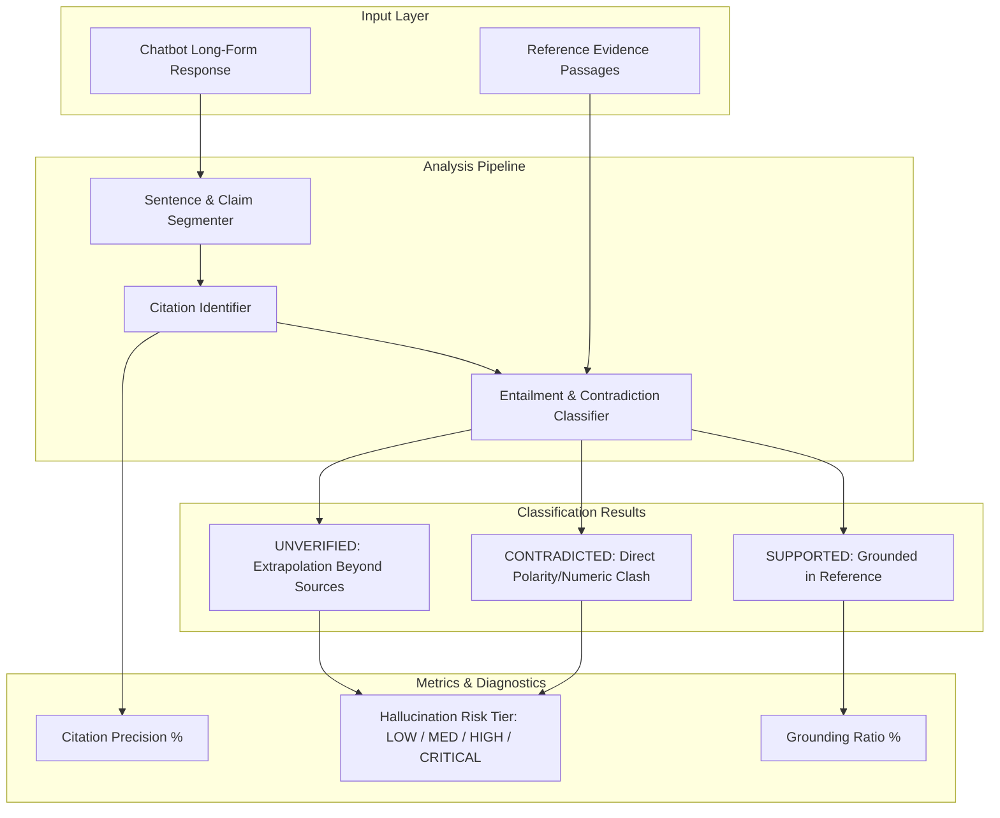

# EvidenceCheck: Automated Fact-Checking & Citation Verification Engine

[](https://github.com/SriRamKunamsetty/evidencecheck/actions)
[](https://fastapi.tiangolo.com)
[](https://docs.pydantic.dev)
[](https://www.docker.com/)

> **EvidenceCheck** is an automated fact-checking and citation attribution engine designed to detect LLM hallucinations, check source entailment, and verify citation hygiene against reference corpora.

---

## 🎯 Alignerr Competency Mapping

| Alignerr Role Competency | How EvidenceCheck Proves Mastery |
| :--- | :--- |
| **Evaluating Factual Accuracy** | Parses long-form chatbot answers into atomic testable statements and matches them against source documents. |
| **Spotting Subtle Hallucinations** | Detects semantic polarity inversions (e.g. *causes* vs *prevents*), numeric shifts, and extrapolation hallucinations. |
| **Citation Attribution Verification** | Evaluates citation precision, checking if bracketed references (`[1]`, `[doc-id]`) actually support the claims made. |
| **Production Engineering** | Standalone FastAPI backend, responsive claim-inspection dashboard, Dockerfile, and GitHub Actions CI workflow. |

---

## 🔍 Entailment Architecture



---

## 🚀 Quick Start

### Option 1: Run with Local Python

```bash
# Clone repository
git clone https://github.com/SriRamKunamsetty/evidencecheck.git
cd evidencecheck

# Install dependencies
pip install fastapi uvicorn pydantic pytest httpx ruff

# Start the fact-checking server
uvicorn app.main:app --reload --port 8000
```
Open [http://localhost:8000](http://localhost:8000) in your browser.

### Option 2: Run with Docker

```bash
docker build -t evidencecheck .
docker run -p 8000:8000 evidencecheck
```

---

## 🧪 Running Automated Tests & Linting

```bash
# Run complete test suite
pytest -v tests/

# Run static analysis
ruff check .
```

---

## 📡 API Reference

- `GET /health` — Service health check.
- `GET /api/benchmark-dataset` — Returns pre-curated fact-checking cases.
- `POST /api/verify` — Evaluates a chatbot response against reference evidence documents.
- `POST /api/reports/markdown` — Generates a publication-ready Markdown citation audit.

---

## 👤 Author
**Sri Ram Kunamsetty** — AI Evaluation & Robustness Specialist  
[GitHub Profile](https://github.com/SriRamKunamsetty)
